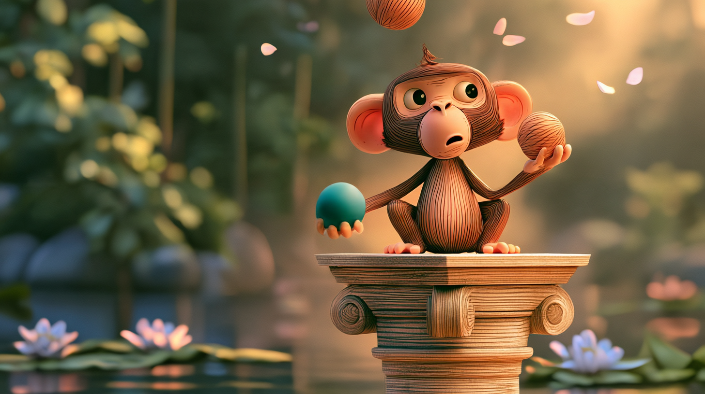

```{=html}
<div class="derailed-home">

  <header class="home-hero" aria-labelledby="home-title">
    <div class="hero-copy">
      <p class="home-eyebrow">AN INDEPENDENT JOURNAL OF CURIOUS DETOURS</p>
      <h1 id="home-title">One thing led to <em>another.</em></h1>
      <p class="hero-lede">A collection of questions that got a little out of hand. Maps, open data, photographs, experiments, and the occasional investigation nobody asked for.</p>
      <a class="home-primary-link" href="#stories">Follow the first detour <span aria-hidden="true">↗</span></a>
      <p class="hero-smallprint">NO FIXED DESTINATION &nbsp;·&nbsp; EST. 2026</p>
    </div>

    <div class="home-doodle" aria-hidden="true">
      <div class="doodle-ring doodle-ring-one"></div>
      <div class="doodle-ring doodle-ring-two"></div>
      <div class="doodle-route"></div>
      <span class="doodle-start"></span>
      <span class="doodle-end">?</span>
      <span class="doodle-label">DET<span class="doodle-label-o">O</span>UR NO. 001</span>
    </div>
  </header>

  <section class="home-stories" id="stories" aria-labelledby="stories-title">
    <div class="home-section-heading">
      <div>
        <p class="home-eyebrow">THE COLLECTION / 001</p>
        <h2 id="stories-title">Explore the detours<span class="home-period">.</span></h2>
      </div>
      <p>Start somewhere. See where it leads.</p>
    </div>

    <article class="home-feature">
      <div class="feature-copy">
        <p class="home-eyebrow">01 &nbsp;/&nbsp; CLOCKS &amp; COORDINATES &nbsp;/&nbsp; INTERACTIVE STORY</p>
        <h3><a href="stories/vancouver-seattle/index.html">How did Vancouver move one hour away from Seattle?</a></h3>
        <p class="feature-deck">The cities haven't moved. The clocks stopped agreeing. Explore what changes when a border becomes a border between two different times.</p>
        <div class="feature-footer">
          <span class="feature-tag">GEOGRAPHY</span>
          <span class="feature-tag">TIME</span>
          <span class="feature-tag">OPEN DATA</span>
        </div>
        <a class="feature-read" href="stories/vancouver-seattle/index.html">Explore the story <span aria-hidden="true">↗</span></a>
      </div>
      <div class="feature-art" aria-label="Illustrative winter comparison: Vancouver 9 AM, Seattle 8 AM at the same moment on November 2, 2026.">
        <div class="feature-art-top">SAME MOMENT &nbsp;·&nbsp; NOV 02, 2026</div>
        <div class="feature-clock-row">
          <div class="feature-city">
            <span>VANCOUVER</span>
            <strong>09:00</strong>
            <small>UTC−7</small>
          </div>
          <div class="feature-difference" aria-hidden="true">≠</div>
          <div class="feature-city">
            <span>SEATTLE</span>
            <strong>08:00</strong>
            <small>UTC−8</small>
          </div>
        </div>
        <div class="feature-art-bottom"><span class="art-line"></span> DISTANCE UNCHANGED</div>
      </div>
    </article>

    <article class="home-feature">
      <div class="feature-copy">
        <p class="home-eyebrow">02 &nbsp;/&nbsp; MARINE LIFE &nbsp;/&nbsp; INTERACTIVE EXPERIMENT</p>
        <h3><a href="stories/sardine-lab/index.html">Who is leading the sardines?</a></h3>
        <p class="feature-deck">My aunt suspected there was a leader. The sardines declined to comment. Explore how a school of fish can move together with no one in charge.</p>
        <div class="feature-footer">
          <span class="feature-tag">MARINE LIFE</span>
          <span class="feature-tag">SIMULATION</span>
          <span class="feature-tag">EMERGENCE</span>
        </div>
        <a class="feature-read" href="stories/sardine-lab/index.html">Explore Sardine Lab <span aria-hidden="true">↗</span></a>
      </div>
      <div class="feature-art" aria-label="Sardine Lab: a school of fish moving without a leader.">
        <div class="feature-art-top">SARDINE LAB &nbsp;·&nbsp; NO LEADER REQUIRED</div>
        <div class="feature-clock-row">
          <div class="feature-city">
            <span>THE SCHOOL</span>
            <strong>48</strong>
            <small>NEIGHBOURS</small>
          </div>
          <div class="feature-difference" aria-hidden="true">→</div>
          <div class="feature-city">
            <span>THE LEADER</span>
            <strong>?</strong>
            <small>NONE ASSIGNED</small>
          </div>
        </div>
        <div class="feature-art-bottom"><span class="art-line"></span> SIMPLE RULES · SURPRISING PATTERNS</div>
      </div>
    </article>

    <article class="home-feature">
      <div class="feature-copy">
        <p class="home-eyebrow">03 &nbsp;/&nbsp; CURIOSITY &amp; LEARNING &nbsp;/&nbsp; INTERACTIVE STORY</p>
        <h3><a href="stories/find-the-monkey/index.html">Find the Monkey</a></h3>
        <p class="feature-deck">A juggling monkey. A beautiful pedestal. Which should you tackle first? A playful lesson in testing the hard part before polishing the easy one.</p>
        <div class="feature-footer">
          <span class="feature-tag">CURIOSITY</span>
          <span class="feature-tag">EXPERIMENTS</span>
          <span class="feature-tag">EN / 日本語</span>
        </div>
        <a class="feature-read" href="stories/find-the-monkey/index.html">Find the monkey <span aria-hidden="true">↗</span></a>
      </div>
      <div class="feature-art feature-art-monkey" role="img" aria-label="A monkey juggling colorful balls on a pedestal against a woodland background.">
        
        <div class="feature-art-top">BIG AMBITION &nbsp;·&nbsp; SMALL EXPERIMENT</div>
        <div class="feature-monkey-quote">FIRST FIND<br><em>THE MONKEY.</em></div>
        <div class="feature-art-bottom"><span class="art-line"></span> THEN BUILD THE PEDESTAL</div>
      </div>
    </article>

    <article class="home-feature">
      <div class="feature-copy">
        <p class="home-eyebrow">04 &nbsp;/&nbsp; KITCHEN SERIES &nbsp;/&nbsp; INTERACTIVE FIELD GUIDE</p>
        <h3><a href="stories/kitchen-series/five-ways-to-make-a-circle/index.html">Five Ways to Make a Circle</a></h3>
        <p class="feature-deck">Crêpe, tortilla, pancake, flatbread, galette. They look related, but the interesting differences start before the pan. Follow the batter, dough, and blurry boundaries.</p>
        <div class="feature-footer">
          <span class="feature-tag">FOOD</span>
          <span class="feature-tag">CLASSIFICATION</span>
          <span class="feature-tag">KITCHEN SERIES · 001</span>
        </div>
        <a class="feature-read" href="stories/kitchen-series/five-ways-to-make-a-circle/index.html">Explore five circles <span aria-hidden="true">↗</span></a>
      </div>
      <div class="feature-art feature-art-kitchen" role="img" aria-label="Five illustrated round foods: a crêpe, pancake, tortilla, flatbread and galette.">
        <div class="feature-art-top">KITCHEN SERIES &nbsp;·&nbsp; FIELD GUIDE 001</div>
        <div class="kitchen-disc-row" aria-hidden="true">
          <span class="kitchen-disc"></span><span class="kitchen-disc"></span><span class="kitchen-disc"></span><span class="kitchen-disc"></span><span class="kitchen-disc"></span>
        </div>
        <div class="feature-kitchen-quote">SAME SHAPE.<br><em>DIFFERENT STORIES.</em></div>
        <div class="feature-art-bottom"><span class="art-line"></span> BATTER · DOUGH · TRADITION</div>
      </div>
    </article>

    <article class="home-feature">
      <div class="feature-copy">
        <p class="home-eyebrow">05 &nbsp;/&nbsp; COFFEE LAB &nbsp;/&nbsp; INTERACTIVE EXPERIMENT</p>
        <h3><a href="stories/coffee-lab/index.html">What makes a flat white different from a latte?</a></h3>
        <p class="feature-deck">Espresso, milk, foam, and an unexpectedly complicated family tree. Mix ten classic coffee drinks, dress them up, and explore their neighbors on a coffee map.</p>
        <div class="feature-footer">
          <span class="feature-tag">COFFEE</span>
          <span class="feature-tag">INTERACTIVE RECIPES</span>
          <span class="feature-tag">DATA VISUALIZATION</span>
        </div>
        <a class="feature-read" href="stories/coffee-lab/index.html">Enter Coffee Lab <span aria-hidden="true">↗</span></a>
      </div>
      <div class="feature-art feature-art-coffee" role="img" aria-label="Illustrated Coffee Lab: a tiny espresso, a foamy cappuccino, and a layered latte macchiato surrounded by hand-drawn ingredient notes.">
        <div class="feature-art-top">FIELD NOTES &nbsp;·&nbsp; THE ESPRESSO FAMILY</div>
        <svg class="coffee-card-illustration" viewBox="0 0 590 320" xmlns="http://www.w3.org/2000/svg" aria-hidden="true" focusable="false">
          <defs>
            <linearGradient id="coffee-card-glass" x1="0" y1="0" x2="1" y2="0">
              <stop stop-color="#fff9e8" stop-opacity=".4"/>
              <stop offset=".18" stop-color="#fff" stop-opacity=".08"/>
              <stop offset=".84" stop-color="#fff" stop-opacity=".04"/>
              <stop offset="1" stop-color="#fff9e8" stop-opacity=".55"/>
            </linearGradient>
            <linearGradient id="coffee-card-latte" x1="0" y1="0" x2="0" y2="1">
              <stop stop-color="#c68b56"/>
              <stop offset=".5" stop-color="#e6bc85"/>
              <stop offset="1" stop-color="#f4ddaf"/>
            </linearGradient>
          </defs>
          <g stroke="#e4cb9f" stroke-opacity=".27" stroke-dasharray="3 8" fill="none">
            <path d="M34 70H558M34 151H558M34 232H558"/>
            <path d="M90 24V282M194 24V282M298 24V282M402 24V282M506 24V282"/>
          </g>
          <g fill="#f6e4c4" font-family="Georgia,serif" font-style="italic">
            <text x="29" y="47" font-size="25" transform="rotate(-6 29 47)">Same beans.</text>
            <text x="33" y="75" font-size="25" transform="rotate(-6 33 75)">Different drinks.</text>
          </g>
          <g fill="none" stroke="#f1cf91" stroke-width="2" stroke-linecap="round" stroke-linejoin="round" opacity=".88">
            <path d="M92 93 Q133 106 148 155"/>
            <path d="M296 67 Q317 49 361 73"/>
            <path d="M467 109 Q511 99 524 121"/>
          </g>
          <g fill="#f1cf91" font-family="Arial,sans-serif" font-size="11" font-weight="700" letter-spacing="1.5">
            <text x="35" y="105">ESPRESSO</text>
            <text x="251" y="60">FOAM + MILK</text>
            <text x="453" y="97">MILK FIRST</text>
          </g>
          <!-- A small demitasse of espresso. -->
          <ellipse cx="145" cy="244" rx="60" ry="8" fill="#0e211d" opacity=".28"/>
          <path d="M109 169H183L177 231Q145 241 115 231Z" fill="#733c27"/>
          <path d="M110 169H182L180 180H112Z" fill="#d89554"/>
          <path d="M115 179H178L176 187H116Z" fill="#b96939"/>
          <path d="M109 169H183L177 231Q145 241 115 231Z" fill="url(#coffee-card-glass)" stroke="#f9edd7" stroke-width="3"/>
          <path d="M183 184Q210 178 208 200Q205 217 180 214" fill="none" stroke="#f9edd7" stroke-width="7"/>
          <!-- A round cappuccino, with creamy foam and cocoa freckles. -->
          <ellipse cx="291" cy="255" rx="77" ry="9" fill="#0e211d" opacity=".3"/>
          <path d="M230 169H353L341 237Q289 256 243 237Z" fill="#ca8b53"/>
          <path d="M234 195H349L341 236Q290 254 244 236Z" fill="url(#coffee-card-latte)"/>
          <path d="M230 169H353L341 237Q289 256 243 237Z" fill="url(#coffee-card-glass)" stroke="#f9edd7" stroke-width="3"/>
          <path d="M352 185Q387 174 385 204Q380 227 344 220" fill="none" stroke="#f9edd7" stroke-width="9"/>
          <path d="M235 169Q239 149 258 155Q269 130 288 147Q309 130 321 149Q344 145 349 169Q292 185 235 169Z" fill="#f9e8c8" stroke="#fff7e5" stroke-width="3"/>
          <g fill="#b7794b">
            <circle cx="269" cy="155" r="2.4"/><circle cx="291" cy="148" r="2"/><circle cx="313" cy="157" r="2.5"/><circle cx="300" cy="164" r="1.7"/>
          </g>
          <!-- Tall milk-first latte macchiato: milk, coffee mark, airy cap. -->
          <ellipse cx="449" cy="256" rx="59" ry="8" fill="#0e211d" opacity=".28"/>
          <path d="M406 111H491L483 241Q450 253 415 241Z" fill="#f1d7a7"/>
          <path d="M408 117H489L487 147H411Z" fill="#fff2dc"/>
          <path d="M411 146H487L485 164H413Z" fill="#73412d"/>
          <path d="M413 164H485L483 179H415Z" fill="#ce8e5b"/>
          <path d="M415 179H483L481 240Q450 252 418 240Z" fill="#f0d5a2"/>
          <path d="M406 111H491L483 241Q450 253 415 241Z" fill="url(#coffee-card-glass)" stroke="#f9edd7" stroke-width="3"/>
          <ellipse cx="449" cy="111" rx="42" ry="9" fill="#fff5df" stroke="#f9edd7" stroke-width="2"/>
          <path d="M427 113Q437 98 449 112Q463 98 473 113" fill="none" stroke="#ead0ab" stroke-width="2"/>
          <!-- Ingredient annotations on the lab bench. -->
          <g fill="#f9e5c1" font-family="Arial,sans-serif" font-size="12" text-anchor="middle">
            <text x="145" y="273">30 ml</text>
            <text x="291" y="283">espresso · milk · foam</text>
            <text x="449" y="277">milk → espresso</text>
          </g>
          <g fill="none" stroke="#f1cf91" stroke-width="1.5" opacity=".8">
            <circle cx="536" cy="209" r="20" stroke-dasharray="4 5"/>
            <path d="M522 209H550M536 195V223"/>
            <path d="M40 207C59 197 72 200 88 190" stroke-dasharray="3 6"/>
          </g>
          <g fill="#f1cf91" font-family="Georgia,serif" font-size="19" font-style="italic">
            <text x="501" y="245" transform="rotate(-8 501 245)">mix it up!</text>
          </g>
        </svg>
        <div class="feature-art-bottom"><span class="art-line"></span> ONE SHOT · ENDLESS DETOURS</div>
      </div>
    </article>
  </section>

  <section class="home-about" id="about" aria-labelledby="about-title">
    <p class="home-eyebrow">THE IDEA BEHIND DERAILED</p>
    <div class="about-layout">
      <h2 id="about-title">Not everything needs a destination.</h2>
      <div class="about-copy">
        <p>Sometimes it's geography. Sometimes marine life, photography, mathematics, or a completely unnecessary investigation into something surprisingly interesting.</p>
        <p>This is a place to make those detours visible: a field notebook for stories, observations, and small experiments built with whatever tools the question calls for.</p>
        <p class="about-manifesto">A question doesn't need to be important to be worth exploring.</p>
        <a class="about-repo" href="https://github.com/chichacha/derailed" target="_blank" rel="noopener">Explore the working notebook on GitHub ↗</a>
      </div>
    </div>
  </section>

</div>
```
