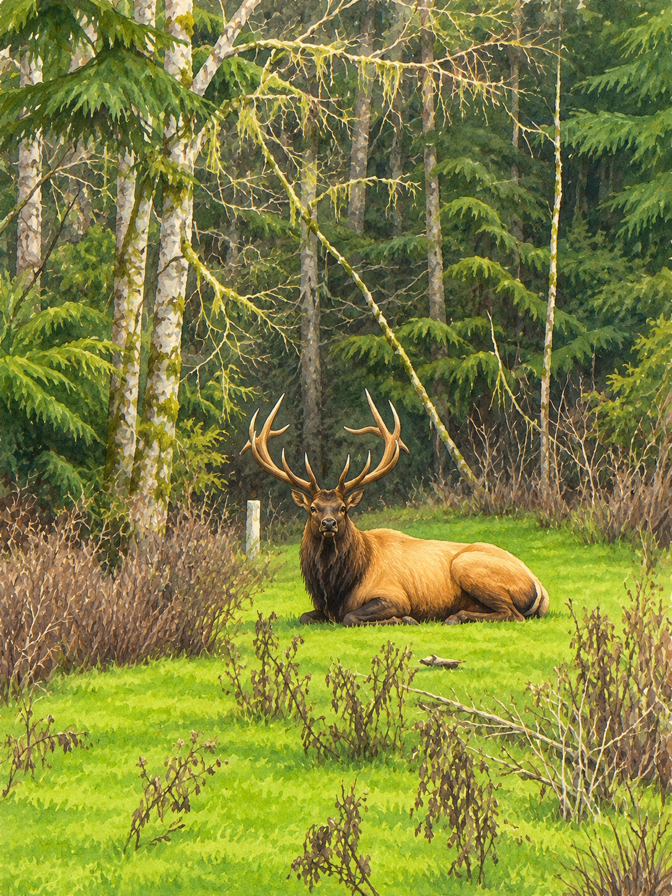

# The Great Elk Identity Crisis 🦌

A standalone, scrolling DERAILED field note, inspired by a resting Roosevelt elk spotted on Vancouver Island.

Open `index.html` directly in a browser—no build step, no CDN, no dependencies. The main character is an **inline SVG illustration**, not the original photograph. It is intentionally easy to recolour and animate.

## Learn by tinkering (suggested order)

1. **CSS design tokens**: change `--paper`, `--ink`, `--rust` in `:root` and watch the whole story change.
2. **SVG + CSS animation**: find `.antlers` and `@keyframes sway`; alter rotation and timing. The resting elk has its own little blink animation.
3. **IntersectionObserver**: tweak `threshold: .12` to see how scroll-triggered reveal timing changes. Compare with scroll listeners.
4. **requestAnimationFrame**: inspect the progress bar's passive scroll listener and how it batches visual updates.
5. **Data-driven interaction**: edit the `names` JavaScript object; the CA / UK / JP controls render the same interface from three small data records.
6. **SVG state**: the white-rump button toggles opacity of a named SVG path; a good starting point for more anatomy annotations.
7. **Accessibility**: test tab/Enter controls, `aria-pressed`, text replacement, and your OS 'reduce motion' setting.

## A possible painted illustration upgrade

The page uses an original vector drawing by default. To use the painted elk illustration from the ChatGPT conversation, save that image as `elk-painting.png` beside `index.html` and add an image element in the hero's `.illustration` container. For example:

```html

```

Hide or remove the adjacent `<svg class="elk-svg">` to show the painting instead. For a nicer effect, use the painting as a full-bleed hero background, then transition to the simplified SVG in the next section. The generated painting is **not yet committed** to this branch.

## Editorial / factual guardrails

- 'Wapiti' comes from Shawnee and refers to the elk's pale rump.
- British 'elk' traditionally means moose; British 'moose' is also widely used. It isn't a neat one-for-one language replacement.
- Roosevelt elk were named by C. Hart Merriam in 1897, before Theodore Roosevelt's presidency.
- The Jasper vs Vancouver Island comparison is geographic context, not proof of an individual animal's subspecies.
- The small-deer / elk scale panel is deliberately illustrative and not to numerical scale. The large emoji is a moose icon placeholder, **not** an elk anatomy diagram—replace it with a true elk SVG later.

Sources are linked in the footer of the article.

## Publishing

`_quarto.yml` lists `stories/elk-identity-crisis/` under `project.resources`. Run `quarto render` from the repository root, then commit the new `docs/stories/elk-identity-crisis/` output to publish through the site's established Pages workflow. No homepage link has been added yet; review the story first.

Possible next experiments: sticky-scrollytelling scene, sprite-sheet anatomy changes, pinning the illustration during chapter transitions, or a small terminology game.
